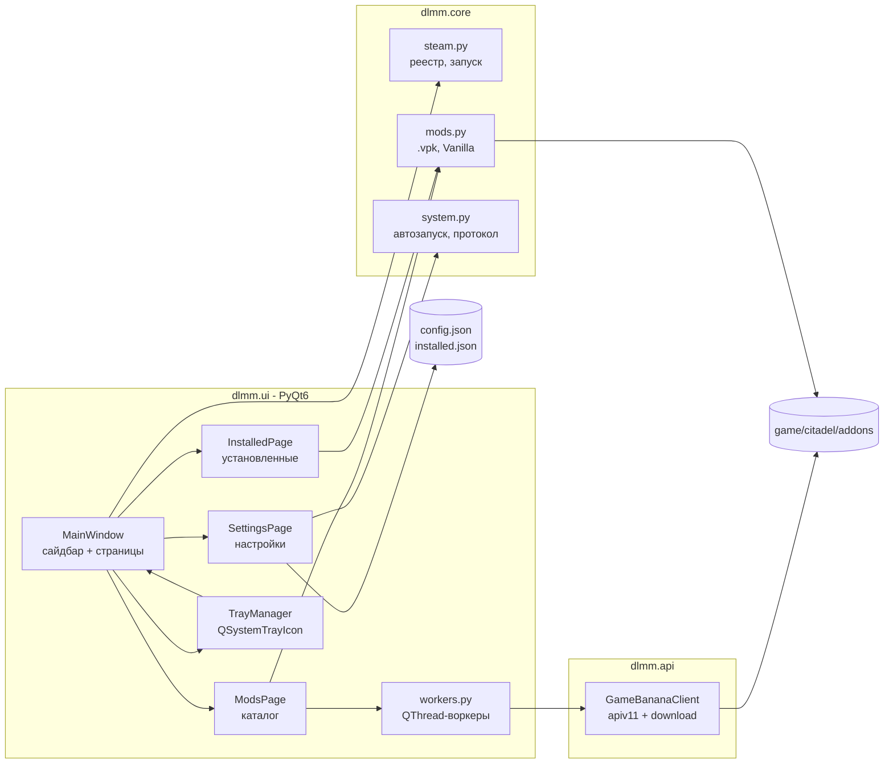

# Архитектура Deadlock Mod Manager

## Общая схема



Слой `dlmm.core` и `dlmm.api` ничего не знают о Qt — только Python. Это
позволяет тестировать ядро без GUI и при необходимости переносить на другой
фреймворк (например, WPF).

## Модули

| Модуль | Ответственность |
| --- | --- |
| `run.py` | точка входа, вызов `dlmm.main.main()` |
| `dlmm/main.py` | QApplication, тема, **один экземпляр** (QLocalServer), стартовое восстановление Vanilla, обработка ссылок `deadlock-mod-manager://` |
| `dlmm/config.py` | константы (Steam AppID 1422450, GameBanana Game ID 20948, путь addons) и `Settings` (JSON в `%APPDATA%`) |
| `dlmm/paths.py` | пути к ресурсам с поддержкой `sys._MEIPASS` (PyInstaller) |
| `dlmm/api/gamebanana.py` | HTTP-клиент apiv11: лента, профиль мода, стриминговое скачивание с прогрессом/отменой; парсер ссылок `mmdl` |
| `dlmm/core/steam.py` | `SteamPath` из реестра, библиотеки из `libraryfolders.vdf`, поиск `Citadel`, `steam://rungameid/1422450`, опрос процесса игры (psutil) |
| `dlmm/core/mods.py` | установка/удаление `.vpk`, включение/отключение (`.vpk.off`), **Vanilla** (переименование папки addons), база метаданных |
| `dlmm/core/system.py` | автозапуск с Windows (HKCU Run), регистрация/удаление протокола `deadlock-mod-manager://`, открытие папок/ссылок |
| `dlmm/ui/main_window.py` | окно: сайдбар (логотип, навигация, кнопки игры), страницы, Vanilla-вотчер, перехват закрытия окна |
| `dlmm/ui/tray.py` | иконка трея + контекстное меню + всплывающие сообщения |
| `dlmm/ui/mods_page.py` | каталог: пагинация ленты, поиск, превью (QNetworkAccessManager), диалоги скачивания/выбора файла |
| `dlmm/ui/installed_page.py` | таблица установленных модов + действия |
| `dlmm/ui/settings_page.py` | форма настроек, проверка API, применение системных настроек |
| `dlmm/ui/theme.py` | палитра и глобальный QSS |
| `dlmm/ui/widgets.py` | `ModCard`, `DownloadDialog`, форматтеры размеров |
| `dlmm/ui/workers.py` | `ApiWorker`, `CatalogLoader`, `DownloadWorker`, `GameSessionWatcher` (все — QThread) |

## Ключевые сценарии

### 1. Установка мода из каталога

```
ModCard.клик → ModsPage._on_install_clicked(record)
  → ApiWorker(get_mod_profile)            # фон: файлы мода
  → (если файлов много) диалог выбора     # ModFile: id, имя, размер
  → DownloadWorker(download_file)         # фон: стрим в %APPDATA%/downloads/<file_id>/
        прогресс → DownloadDialog         # процент, МБ, скорость, «Отмена»
  → ModManager.install_vpk()              # copy2 → game/citadel/addons/
  → installed.json += метаданные          # mod_id, автор, file_id, дата
  → карточка «Установлен» + сигнал installed_changed
  → (настройка) steam://rungameid/1422450 # запуск игры после установки
```

### 2. Режим Vanilla (запуск без модов)

```
«VANILLA» → ModManager.disable_for_vanilla()
    addons  ->  addons_vanilla_backup    # атомарное переименование папки
  → steam.launch_game()
  → GameSessionWatcher (QThread):
        до N секунд ждём процесс citadel.exe,
        затем ждём его завершения (опрос 2 c, флаг stop для выхода)
  → по завершении: ModManager.restore_after_vanilla()
        addons_vanilla_backup  ->  addons  # обратно
  → уведомление в трее + обновление списка
```

Отказоустойчивость:

* если приложение закрыли во время Vanilla-сессии, а игра уже не работает —
  моды возвращаются в `shutdown_cleanup()` (хук `aboutToQuit`);
* если игра ещё запущена — на следующем старте приложения резервная папка
  восстанавливается автоматически («зависший» Vanilla невозможен);
* если игра пересоздала пустую папку `addons` — содержимое аккуратно
  сливается, дубликаты не затираются;
* ручная кнопка «Вернуть моды после Vanilla» в сайдбаре и в меню трея.

Флаг `-vanilla` движком Source 2 для Citadel документированно не
поддерживается, поэтому используется физическое временное отключение файлов —
это гарантирует чистый запуск в 100% случаев.

### 3. Сворачивание в трей

```python
# dlmm/ui/main_window.py
def closeEvent(self, event):
    if self._settings.minimize_to_tray and not self._force_quit and self._tray:
        event.ignore()          # окно не закрывается
        self.hide()             # сворачивается в трей
        ...  # первое скрытие сопровождается подсказкой в трее
        return
    event.accept()
    self.shutdown_cleanup()     # настоящий выход
```

`QApplication.setQuitOnLastWindowClosed(False)` — чтобы скрытие окна не
гробило процесс. Полный выход — только через «Выход» в меню трея
(`force_quit()`).

### 4. Один экземпляр приложения

Второй запуск через `QLocalSocket.connectToServer("DeadlockModManager")`:
если сервер уже слушает — пишем `show` и завершаемся; первый экземпляр по
`newConnection` поднимает окно из трея. Аргументы `--minimized` / автозапуск
с Windows стартуют приложение сразу свёрнутым.

### 5. Установка «в 1 клик» с GameBanana

GameBanana в `_aModManagerIntegrations` отдаёт ссылки вида
`deadlock-mod-manager:https://gamebanana.com/mmdl/<file_id>,Mod,<mod_id>`.
Установщик (или настройка на странице «Настройки») регистрирует протокол в
`HKCU\Software\Classes\deadlock-mod-manager\shell\open\command`. Приложение
принимает URL в argv, распознаёт `file_id`/`mod_id`, тянет профиль мода и
сразу запускает установку нужного файла.

## Потоки и отзывчивость UI

* Любая сеть — в `QThread`: `ApiWorker` (произвольная функция),
  `CatalogLoader` (лента, до 4 страниц за раз — лента отдаёт максимум
  15 записей, часть из них WiP отфильтровывается), `DownloadWorker`
  (прогресс + отмена), `GameSessionWatcher` (опрос процесса).
* Превью — асинхронно через `QNetworkAccessManager` (без потоков).
* Сигналы `pyqtSignal` — единственный мост воркер → UI.
* `GameSessionWatcher.stop()` — корректная остановка при выходе из приложения.

## GameBanana API v11 (проверено 2026-11)

| Маршрут | Назначение |
| --- | --- |
| `GET /Game/20948/Subfeed?_isValidateDate=true&_csvSubfeedTypes=mod&_nPer=15&_nPage=N` | лента модов игры; `_aMetadata._nRecordCount` — всего (~13 тыс.) |
| `GET /Mod/{id}/ProfilePage` | профиль: `_aFiles[]` (`_idRow`, `_sFile`, `_nFilesize`, `_sDownloadUrl` = `https://gamebanana.com/dl/{file_id}`, `_sMd5Checksum`), `_sName`, `_aSubmitter._sName`, описания |
| `GET https://gamebanana.com/dl/{file_id}` | скачивание (302 → CDN, `requests` следует автоматически) |

Поля записи ленты, используемые приложением: `_idRow`, `_sName`, `_sModelName`
(`Mod` показываем, `Wip` фильтруем), `_aSubmitter._sName`, `_aRootCategory/_aSubCategory._sName`,
`_nLikeCount`, `_nViewCount`, `_sVersion`, `_sProfileUrl`,
`_aPreviewMedia._aImages[0]` → `{_sBaseUrl}/{_sFile530|_sFile220|_sFile}`.

Примечание: серверный поиск (`Util/Search/Results`) на момент написания
требует параметр `_sSearchString`, который стабильно отклоняется
(`STRING_TOO_SHORT`) даже с валидным значением; в приложении реализован
клиентский поиск по загруженным карточкам, серверный — в roadmap.

## Данные и состояние

| Хранилище | Содержимое |
| --- | --- |
| `config.json` | `Settings`: путь к игре, процесс, API/зеркало, поведение, размер окна |
| `installed.json` | `{имя.vpk: {mod_id, mod_name, author, file_id, installed_at}}` — именно по `mod_id` каталог помечает «Установлен» |
| `addons/` | активные `.vpk`; отключённые носят суффикс `.vpk.off` |
| `addons_vanilla_backup/` | временная папка Vanilla-режима (существует только во время сессии) |
| `dlmm.log` | лог запусков и необработанных исключений |

## Ошибки, которые не роняют приложение

* битый `config.json` → значения по умолчанию;
* отсутствие `psutil` / запуск не в Windows → функции определения процесса
  и реестра деградируют (возврат None/False), приложение продолжает работать;
* занятые файлы (запущенная игра) → человекочитаемое `ModError`
  «закройте игру», а не traceback;
* необработанное исключение → хук пишет traceback в `dlmm.log` и показывает
  диалог вместо молчаливого краха.
